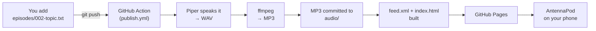

# Study Podcast

Your own private study podcast. You write an episode as plain text; GitHub
turns it into an MP3 with an offline voice and publishes it to a podcast
feed you can subscribe to in AntennaPod.



**Feed URL to subscribe to:**

```
https://keep-dreaming.github.io/study-podcast/feed.xml
```

**Web player (backup):** <https://keep-dreaming.github.io/study-podcast/>

> Both work once the one-time setup below is done and the workflow has run
> on `main` at least once.

---

## Contents

1. [One-time setup](#1-one-time-setup)
2. [Subscribe in AntennaPod](#2-subscribe-in-antennapod)
3. [Add an episode](#3-add-an-episode)
4. [Change the voice](#4-change-the-voice)
5. [Fix a mispronounced word](#5-fix-a-mispronounced-word)
6. [Re-record an episode](#6-re-record-an-episode)
7. [What each file does](#7-what-each-file-does)
8. [How the workflow works, step by step](#8-how-the-workflow-works-step-by-step)
9. [Run it on your own computer (optional)](#9-run-it-on-your-own-computer-optional)
10. [Troubleshooting](#10-troubleshooting)

---

## 1. One-time setup

GitHub Pages has to be switched on once, by you. (The workflow can't do
it for you, because that needs admin rights on the repository.)

1. On github.com, open the repository, then **Settings** → **Pages**
   (left sidebar).
2. Under **Build and deployment** → **Source**, choose **GitHub Actions**.
3. Get the workflow onto `main` (merge the branch or pull request that
   adds these files). Every push to `main` starts the workflow.
4. Open the **Actions** tab and watch the **Publish podcast** run. The
   first run takes about 4 minutes: it downloads the voice and records
   episode 001. Later runs that only change text take about 30 seconds.

If a run fails before step 3 was done (Pages not enabled yet), open the
failed run and click **Re-run all jobs**.

## 2. Subscribe in AntennaPod

* **Easiest:** open the [web page](https://keep-dreaming.github.io/study-podcast/)
  on your phone and tap **Open in AntennaPod**.
* **Manually:** in AntennaPod tap **Add podcast** → **Add podcast by RSS
  address**, and paste the feed URL above.

New episodes show up when AntennaPod refreshes. Pull down on the podcast
to refresh right away.

## 3. Add an episode

### The script format

Create a new `.txt` file in the `episodes/` folder. It needs a small
header, then a line with just `---`, then the words to speak:

```text
title: Subnetting Basics
description: What a subnet mask is and how to read CIDR notation.
date: 2026-12-04
---
Hello, and welcome back. Today is all about subnetting.

A blank line starts a new paragraph. You get a short pause between
paragraphs, so the episode doesn't sound rushed.

Here's a quiz question. What does slash twenty four mean? [pause 6] It means
the first twenty four bits are the network part.
```

| Header field  | Required | Notes |
|---------------|----------|-------|
| `title`       | yes      | Episode title in the podcast app. |
| `description` | no       | Shown under the title. |
| `date`        | yes      | `YYYY-MM-DD` (or `YYYY-MM-DD HH:MM`). Sets the order: newest first. |

Rules for the text below the `---` line:

* **Blank line = new paragraph.** Line breaks inside a paragraph don't
  matter. Wrap lines however you like.
* **`[pause]`** inserts 3 seconds of silence; **`[pause 6]`** inserts 6
  seconds. Put it anywhere. Great for quizzes.
* **File name = episode ID.** Use lowercase letters, numbers and hyphens,
  e.g. `002-subnetting.txt`. A number at the front keeps them in order.
  Don't rename a file after it's published: podcast apps would see it as
  a new episode.
* **Drafts:** keep unfinished scripts outside `episodes/` (a `drafts/`
  folder, say). Only `episodes/*.txt` is published.

**Writing for the ear:** short sentences. Say what's coming ("Part two.
Remembering the layers."). Recap after each section. Write numbers the way
you'd say them ("port four four three"). Skip tables, code and bullet
symbols, since the voice can't show them. About 140 words make one
minute of audio.

### Option A: on github.com (no git needed)

1. Open the `episodes/` folder → **Add file** → **Create new file**.
2. Name it, e.g. `002-subnetting.txt`, and paste your script.
3. Click **Commit changes…** → keep **Commit directly to the `main`
   branch** → **Commit changes**.
4. Watch the **Actions** tab. When the run is green, the episode is live.

### Option B: from your computer with git

```bash
git pull
```

Always pull first: the workflow adds MP3 files to the repo, so your copy
is usually one commit behind. Then add your script and push:

```bash
git add episodes/002-subnetting.txt
```

```bash
git commit -m "Add episode 002: subnetting"
```

```bash
git push
```

If `git push` is rejected with *"Updates were rejected because the remote
contains work that you do not have"*, run `git pull` and push again.

## 4. Change the voice

The voice is set in **one place**: `podcast.toml`, under `[voice]`:

```toml
model = "en_US-ryan-high"
```

1. Listen to the voices at <https://rhasspy.github.io/piper-samples/>.
2. Replace the value with the name you like, e.g. `"en_US-lessac-medium"`
   or `"en_GB-alan-medium"`.
3. Commit and push.

The workflow downloads the new voice automatically (and caches it). Only
**new** episodes use it; existing MP3s stay as they are (see
[Re-record an episode](#6-re-record-an-episode)).

The same section also sets the speaking speed (`length_scale`) and the
pause lengths.

## 5. Fix a mispronounced word

Text-to-speech guesses how to say abbreviations, and sometimes guesses
wrong. Piper says "OSI" as "oh-see", for example. Add the word to the
`[pronounce]` section of `podcast.toml`:

```toml
[pronounce]
"OSI" = "O S I"
```

Your scripts keep the normal spelling; only the audio changes. Matching is
whole-word and case-sensitive. Tip: plurals of acronyms often need their
own entry (`"NICs" = "nicks"`).

## 6. Re-record an episode

An episode is recorded once, when its script has no MP3. To record it
again (after fixing a typo, or to use a new voice), delete its MP3 and
push:

```bash
git pull
```

```bash
git rm audio/001-osi-model.mp3
```

```bash
git commit -m "Re-record episode 001"
```

```bash
git push
```

(On github.com: open the MP3 in `audio/` → **⋯** menu → **Delete file**.)

## 7. What each file does

```text
study-podcast/
├── .github/workflows/publish.yml   the automation (GitHub Action)
├── episodes/                       your scripts, one .txt per episode
│   └── 001-osi-model.txt
├── audio/                          MP3s, created by the workflow (don't edit)
├── site/
│   ├── index.html                  the web player page
│   └── cover.png                   podcast artwork (1400×1400)
├── scripts/
│   ├── common.py                   shared code: reads config + scripts
│   ├── make_audio.py               script text → WAV → MP3
│   └── build_site.py               builds _site/ and feed.xml
├── podcast.toml                    ALL settings: title, voice, pauses…
├── requirements.txt                Python packages to install (Piper)
├── .gitignore                      files git should never commit
└── README.md                       this file
```

* **`.github/workflows/publish.yml`**: the workflow. GitHub runs it
  automatically on every push to `main`. Every line is commented; see
  the next section for a walkthrough.
* **`episodes/*.txt`**: your episode scripts. The only folder you
  normally touch.
* **`audio/*.mp3`**: one MP3 per script, with the same name. The
  workflow commits these. *Why keep them in the repo?* So the workflow
  can tell which scripts are already recorded (it only records missing
  ones), and so your audio is safely stored with your scripts. At 64 kbps
  that's about 0.5 MB per minute: 100 fifteen-minute episodes is
  about 750 MB, fine for a personal repo. (GitHub Pages sites can be up to
  1 GB.)
* **`podcast.toml`**: the one settings file: podcast title,
  description, author, **voice**, speed, pause lengths, MP3 bitrate,
  loudness, and pronunciation fixes. TOML is a simple `key = value`
  format.
* **`scripts/common.py`**: reads `podcast.toml`, parses each script's
  header, and splits text into paragraphs and `[pause]` markers. Shared
  by the other two scripts so the rules live in one place.
* **`scripts/make_audio.py`**: for each script without an MP3: Piper
  speaks it paragraph by paragraph into one WAV file (adding silence
  between sentences and paragraphs), then ffmpeg converts it to a mono MP3
  and evens out the volume to the podcast standard (−16 LUFS). With
  `--check` it only lists what's missing.
* **`scripts/build_site.py`**: creates `_site/` with `index.html`,
  `cover.png`, the MP3s, and generates **`feed.xml`**, the podcast RSS
  feed. Each episode is an `<item>` with title, description, publication
  date, duration, and an `<enclosure>` tag (the MP3's URL, size and
  type), which is what tells podcast apps where the audio is.
* **`site/index.html`**: the backup web player. It contains no episode
  data itself: in your browser it loads `feed.xml` and shows each
  episode with an audio player. One source of truth: the feed.
* **`requirements.txt`**: `piper-tts==1.8.0`, the maintained Piper
  project ([OHF-Voice/piper1-gpl](https://github.com/OHF-Voice/piper1-gpl)).
  Pinned so a new release can't silently change your audio.
* **`.gitignore`**: keeps `_site/` (rebuilt every run) and `voices/`
  (100+ MB voice models) out of git.

## 8. How the workflow works, step by step

Some vocabulary first:

* A **workflow** is an automated process, defined in a YAML file in
  `.github/workflows/`.
* It starts on a **trigger** (here: a push to `main`, or the **Run
  workflow** button).
* It contains **jobs**. Each job runs on a fresh, temporary Linux
  machine called a **runner**, which is wiped afterwards.
* A job is a list of **steps**: either `uses:` (a ready-made *action*
  written by someone else, like `actions/checkout`) or `run:` (shell
  commands).

`publish.yml` has two jobs:

### Job 1: `build`

| # | Step | What & why |
|---|------|-----------|
| 1 | Check out the repository | Copies your repo onto the runner, which starts empty. Uses the newest `main`, so MP3s committed by an earlier run are seen. |
| 2 | Configure GitHub Pages | Gets the site's public URL (needed inside `feed.xml`). Fails early if Pages isn't enabled. |
| 3 | Set up Python | Installs Python 3.12. |
| 4 | Find scripts that still need an MP3 | Runs `make_audio.py --check`. Passes `needed=true/false` and the voice name to later steps as **step outputs**. Also catches header typos. |
| 5 | Make sure ffmpeg is installed | Installs it with `apt` only if the runner doesn't already have it. |
| 6 | Install Piper | `pip install -r requirements.txt`. *Only if needed.* |
| 7 | Restore cached voice model | `actions/cache` restores `voices/` from a previous run, keyed by voice name. *Only if needed.* |
| 8 | Download the voice model | `python3 -m piper.download_voices`. *Only if needed and the cache missed* (first run, or new voice). |
| 9 | Generate the missing MP3s | `make_audio.py`: Piper → WAV → ffmpeg → MP3. ~3 minutes per 15-minute episode. |
| 10 | Commit the new MP3s | The bot commits `audio/*.mp3` back to `main`, so the next run skips them. Commits made this way don't trigger another run, so there's no loop. |
| 11 | Build the website and RSS feed | `build_site.py` creates `_site/` with `feed.xml`. |
| 12 | Upload the website | Packages `_site/` as a *Pages artifact* for the next job. |

Steps 6–10 have an `if:` condition, so when there's nothing to record
they're skipped and the run takes about 30 seconds.

### Job 2: `deploy`

`needs: build` makes it wait for job 1. Its single step,
`actions/deploy-pages`, publishes the artifact to GitHub Pages. The
`environment: github-pages` setting shows the live link on the run page.

### Other things in the file worth knowing

* **`permissions:`**: each job gets only the rights it needs for the
  automatic `GITHUB_TOKEN`: `contents: write` to commit MP3s;
  `pages: write` and `id-token: write` to deploy. This is the *least
  privilege* principle.
* **`concurrency:`**: if you push twice quickly, the second run waits
  for the first instead of both committing at once.
* **`${{ ... }}`** is GitHub's expression syntax, e.g.
  `${{ steps.check.outputs.voice }}` reads an output of the step with
  `id: check`. Values are passed to shell commands through `env:`
  variables, a security habit that keeps text from being run as code.

## 9. Run it on your own computer (optional)

You don't need this, since GitHub does everything. But to preview an
episode before pushing (Linux or macOS, Python 3.11+, ffmpeg installed):

```bash
python3 -m venv .venv
```

```bash
source .venv/bin/activate
```

```bash
pip install -r requirements.txt
```

```bash
python3 -m piper.download_voices --download-dir voices en_US-ryan-high
```

```bash
python scripts/make_audio.py
```

```bash
python scripts/build_site.py
```

```bash
python3 -m http.server --directory _site 8000
```

Then open <http://localhost:8000>. If you don't want a locally made MP3
published, delete it from `audio/` before you commit, and the workflow
will record its own.

## 10. Troubleshooting

* **Red X on the run, "Get Pages site failed"**: Pages isn't enabled
  with source *GitHub Actions*. See [one-time setup](#1-one-time-setup),
  then **Re-run all jobs**.
* **"header is missing" / "no '---' line found"**: check the top of
  your script against the format in [section 3](#3-add-an-episode). The
  error names the file.
* **"Commit the new MP3s" fails with 403 or "protected branch"**: a
  branch protection rule (or ruleset) on `main` is blocking the bot.
  Check **Settings** → **Branches** / **Rules**, and allow GitHub Actions
  to push to `main` or remove the rule. If that's not it, set
  **Settings** → **Actions** → **General** → **Workflow permissions** to
  **Read and write permissions**, then re-run.
* **`git push` rejected on your computer**: run `git pull` first (the
  workflow added MP3s since your last pull).
* **The episode isn't in AntennaPod yet**: check that the Actions run is
  green, then refresh the podcast in AntennaPod.
* **A word sounds wrong**: add it to `[pronounce]` in `podcast.toml`
  and [re-record](#6-re-record-an-episode) the episode.
